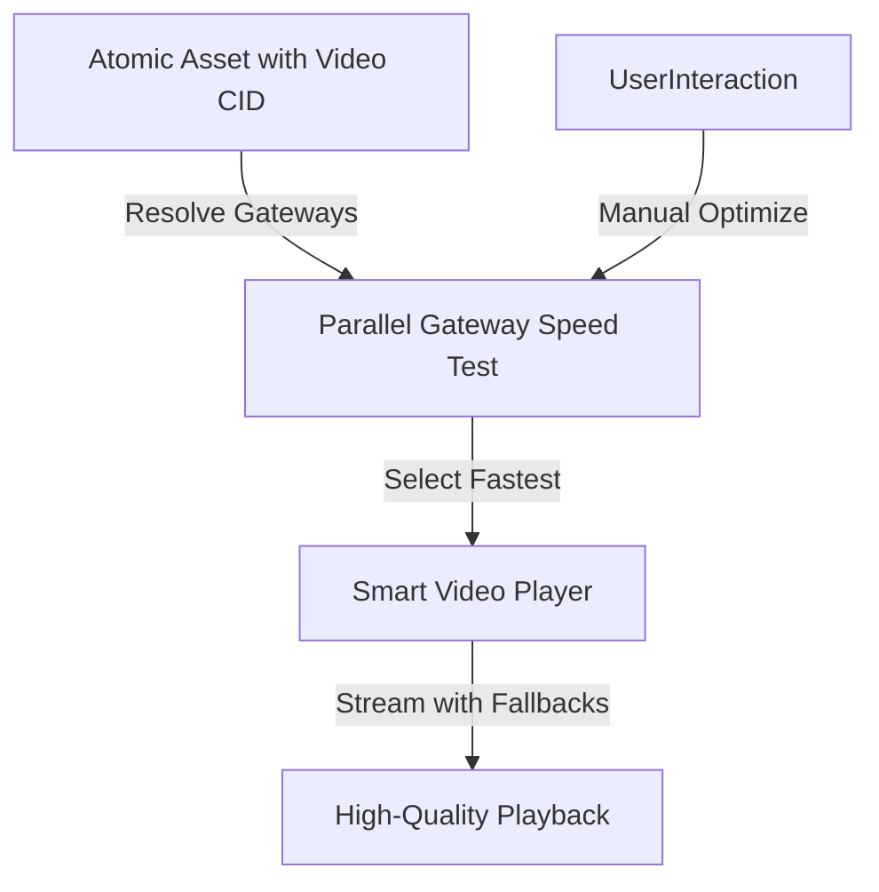

# wax-video-nft-streaming-buffer-optimizer — Video NFT Streaming Buffer & Gateway Optimizer

> **Status:** 🔒 Private (In Development) | Target Public Release: August 2026  
> **Category:** Spatial Audiovisual Web & Interactive Multi-Media Players  
> **Parent Catalog:** [pixel-journey/wax-ecosystem-blueprint-catalog](https://github.com/pixel-journey/wax-ecosystem-blueprint-catalog)

**One-sentence goal:** A smart, lightweight media component that automatically tests multiple public IPFS gateways in real time and selects the fastest one for streaming high-fidelity Video NFTs, with intelligent buffering, fallback, and progressive loading to deliver the smoothest possible playback experience.

---

## 1. Overview & Goal

This blueprint solves one of the biggest UX pain points for Video NFTs: slow or unreliable loading due to gateway performance. It makes Video NFT playback reliable and delightful.

- **Why it matters for WAX:** Video NFTs are powerful but often suffer from poor loading UX. Fast, reliable streaming increases engagement and perceived quality of collections.
- **Public infrastructure only:** Multiple public IPFS gateways (tested dynamically), AtomicAssets for video metadata, client-side speed testing and adaptive streaming. No custom contracts or paid CDNs.
- **Target users:** Video NFT collectors, platforms embedding Video NFTs, artists releasing video drops, anyone wanting reliable playback.
- **Success metrics:** "Start playing high-quality Video NFT in <3s even on average connections", "Automatic fallback if a gateway slows down", "Beautiful loading states that feel instant".

---

## 2. Concepts & Inspiration

- **Core concepts:** IPFS gateways have variable performance. Client can ping/test multiple gateways in parallel or sequentially, measure latency/throughput for the specific video CID, and switch dynamically. Combined with range requests or adaptive bitrate where possible.
- **Pain points:** Video NFTs often buffer forever or start at low quality. Users have no control or visibility.
- **Inspirations:** Video streaming players with adaptive bitrate (YouTube, Vimeo), IPFS gateway speed testers, modern progressive web video components. Web3: smart client-side gateway intelligence for owned assets.
- **Cross-references:** Perfect with `wax-ipfs-gateway-speed-test-matrix` (the general tool), `wax-progressive-nft-metadata-hydration-grid`, and other performance blueprints in Category 5. Great companion to any visual/ generative blueprints.

---

## 3. Design Specifications (Pixel Journey Standards)

### 3.1 Visual & Interaction Design
- Clean video player wrapper with subtle gateway status indicator (current gateway + speed badge).
- Elegant loading states: skeleton video frame + progressive quality ramp-up.
- Micro-interactions: Smooth quality switch, subtle toast when gateway is optimized.
- Controls: Standard play/pause/scrub + optional "Optimize Gateway" button for manual trigger.
- Responsive: Full featured on desktop; touch-optimized mobile player.

### 3.2 Key Views / Components
- `OptimizedVideoPlayer.tsx` — Main smart video element with gateway logic.
- `GatewayStatusBadge.tsx` — Small indicator showing current gateway and performance.
- `AdaptiveBufferManager.tsx` — Internal logic for buffering strategy and fallbacks.
- `QualitySelector.tsx` (optional) — Manual quality/gateway override for advanced users.

### 3.3 Accessibility (A11y) & Inclusive Design
- WCAG 2.2 AA: Full native video accessibility (captions if available, keyboard controls, screen reader support), high contrast controls.
- Clear status announcements for gateway changes.
- Fallback to standard HTML5 video if optimization fails.

### 3.4 Performance & Optimization Targets
- Very fast initial gateway selection (parallel HEAD requests or small range probes).
- Efficient buffering with range requests where supported.
- Minimal overhead; the component should feel like a native fast video player.
- Target: Reliable 1080p+ playback on average connections.

---

## 4. Technical Architecture

### 4.1 Core Tech Stack
- Next.js 15 + TypeScript + Tailwind
- Native HTML5 video + Media Source Extensions where beneficial
- Simple gateway speed testing (fetch with timing or small range requests)
- AtomicAssets for video metadata and CID resolution
- date-fns or simple timers for performance tracking

### 4.2 Data Flow Diagram


### 4.3 Folder Structure
```
app/
├── components/
│   ├── video/
│   │   ├── OptimizedVideoPlayer.tsx
│   │   ├── GatewayStatusBadge.tsx
│   │   └── AdaptiveBufferManager.ts
├── hooks/useOptimizedVideo.ts
├── lib/
│   ├── ipfs/
│   │   └── gateway-tester.ts
│   └── video/
│       └── buffer-strategy.ts
└── types/video.ts
```

### 4.4 Security & Privacy
- Pure client-side. No data sent to third parties beyond public gateway requests.
- Clear fallback behavior if all gateways are slow.

---

## 5. Implementation Examples & Code Snippets

**Gateway speed test (core logic)**
```ts
// lib/ipfs/gateway-tester.ts
export async function findFastestGateway(cid: string, gateways: string[]) {
  const results = await Promise.allSettled(
    gateways.map(async (gw) => {
      const start = performance.now();
      await fetch(`${gw}/ipfs/${cid}`, { method: 'HEAD', signal: AbortSignal.timeout(3000) });
      return { gateway: gw, time: performance.now() - start };
    })
  );
  return results
    .filter(r => r.status === 'fulfilled')
    .sort((a, b) => (a as any).value.time - (b as any).value.time)[0];
}
```

**Smart player component**
```tsx
<video
  ref={videoRef}
  src={selectedGatewayUrl}
  onError={tryNextGateway}
  controls
/>
```

---

## 6. Demo & Testing
- Demo mode with sample Video NFTs and multiple gateways.
- Live mode with real Video NFTs.
- Performance tests: gateway switching speed, buffering under variable network.
- Fallback and error handling tests.

---

## 7. Roadmap
Phases: Gateway testing engine → Smart video player wrapper → Adaptive buffering & UI polish → a11y & docs.

Future: Integration with `wax-ipfs-gateway-speed-test-matrix`, support for HLS/DASH if available on gateways, background preloading for collections.

---

## 8. Visual References
> Clean, modern video player like Vimeo or YouTube but with subtle Web3 touches (gateway status, on-chain proof link). Elegant loading animations, clear performance indicators. Reference: high-quality custom video players in web apps.

---

## 9. Related Blueprints
- `wax-ipfs-gateway-speed-test-matrix` — The general testing tool this builds upon.
- `wax-progressive-nft-metadata-hydration-grid` — Similar progressive loading philosophy.
- Other performance and audiovisual blueprints.

---

## 10. License & Credits
MIT. Built to make Video NFT playback reliably excellent on WAX public infrastructure.

**Pixel Journey — Beautiful interfaces for public blockchain data.**
